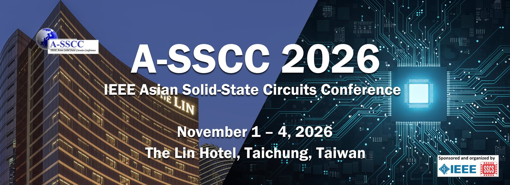

_A-SSCC 2026 banner, from the conference website (a-sscc2026.org)_

The 2026 IEEE Asian Solid-State Circuits Conference (A-SSCC) came to Taichung this November, and it was my first time attending a conference. I focus on digital IC design, but I want to move into mixed-signal design, merging analog with what I know of digital, to improve my overall skill set and toolbox. So when one of my NCHU professors suggested that I attend as a senior undergraduate, I applied right away with my friends, who also got the news.

<figure class="post-figure post-figure--right">
  
  <figcaption>A-SSCC 2026 at the Lin Hotel, Taichung</figcaption>
</figure>

Over the Circuit Insights sessions, professors and engineers from universities and industry covered topics from FinFETs to SerDes. The whole day was recorded and will be posted on the IEEE Solid-State Circuits Society’s [YouTube channel](https://www.youtube.com/@IEEESolidStateCircuitsSociety/playlists). You can spot me in the audience, asking a question during the panel discussion. I learned a lot about analog design, not only from the five lectures, but also from asking the professors my own questions during coffee breaks and listening to what my friends (pure analog IC design undergraduates) asked the other speakers.

As someone who spent most of my [capstone project](../../category/research/#snn-capstone) and the second half of my junior year on purely digital design, I still found the sessions manageable to follow as an electrical engineer. A few concepts are hard if you haven’t worked with them before, such as power management ICs (PMICs), transceivers (TX), and SerDes. But if you know the basics of IC design, you can keep up, with a few quick Google searches along the way to understand the proper nouns they use.

One of the most memorable professors at the conference for me was Prof. Ali Sheikholeslami, the first speaker of the day, who introduced FinFETs as a whole, why they matter, and the basics of how they are better than the planar version. His session was the easiest and most light-hearted to follow. You might think that’s because this topic had the simplest concepts, but I think it was how confidently he presented his slides and how he delivered the talk. He explained each concept in a way that was easy to follow and packed with insight, which made it fun to listen to. This is the kind of teaching I want to do in the future if I get the chance: to teach with passion.

During the lunch break, I waited until Prof. Ali Sheikholeslami (analog and mixed-signal IC design professor) was free and asked what he thought about someone like me, a student focused mainly on digital IC design, learning analog to move into mixed-signal design. I had some doubts, because some labs and companies that work on mixed-signal ICs split the work between different kinds of designers, keeping a clear line between digital and analog components. So I wasn’t sure whether my work on analog was even meaningful. Prof. Sheikholeslami said that learning the basics of analog is a good idea. Digital designers still need to understand analog if they want to work on mixed-signal designs, and it helps in industry too, because companies are more likely to hire an engineer who has a deeper understanding of analog concepts than one who doesn’t. He suggested that after my FinFET op-amp layout, I could keep learning from the Circuit Insights free videos online, or ask my research advisor.

The second speaker, Dr. Ruey-Bin Sheen from TSMC, talked about using pre-characterized analog cells with a fixed height and fixed routing tracks. They work like digital standard cells, which makes analog layouts smaller and avoids the design-rule (DRC) problems that come from hand-drawn shapes. After the whole conference, we had a quick conversation about how AI is affecting jobs in the industry and how TSMC is approaching it.

During the panel discussion, someone asked how the panelists chose between industry and academia for their careers. They said that the most important thing is passion: doing what you want to do will carry you the furthest. It’s also fine to switch sides after years of work, because people change. Two of the professors on the panel had moved from industry to academia because they wanted to work on what interested them, without being limited by a company. Prof. Sheikholeslami (being a professor his whole career) added a twist: people must get to choose, because there is no single right answer. If everyone went into academia, teaching would lose its purpose, because everyone is important in their roles. If no one works in industry, nothing gets built, and what is the point of teaching the next generation if not to improve our society? The panelists also said that working in industry makes you proud of what you’ve done, because you get to see your work turned into real products that people use.

As a follow-up, I asked, “What experience or insight did you bring from industry when you moved back to academia?” I was curious because I also plan to work in industry first, and then go back to pursue a PhD, so that I can teach and give back to the academic community. They said that in industry, a design is tested across thousands of cases, checking every corner and every possible working condition, like temperature. In academia, there is less testing; you mainly need to make sure the design works well enough to publish. It was a very interesting answer to hear.

<figure class="post-figure post-figure--right">
  
  <figcaption>The bento box that was given at the conference</figcaption>
</figure>

Besides everything I learned, the conference also gave us a really good bento box for lunch, and the desserts at the coffee break were nice too. I grabbed a few on a plate, but the next session started before I could eat them, so they sat on the table in front of me until the end of the day. I didn’t want to be seen eating in the middle of a talk or the panel. I also hadn’t picked up a fork, so I had to wait for the session to finish before I could get up and get one.
