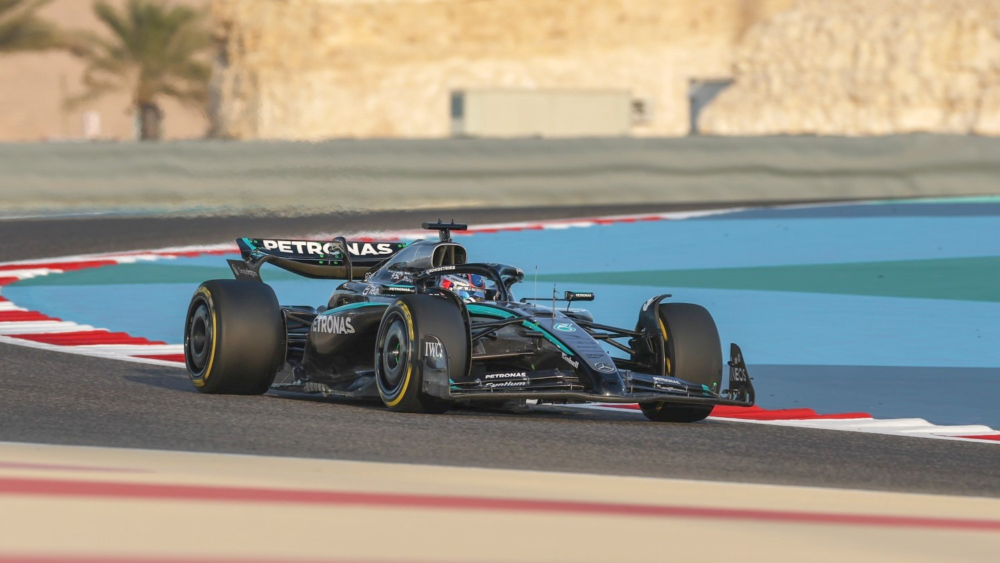
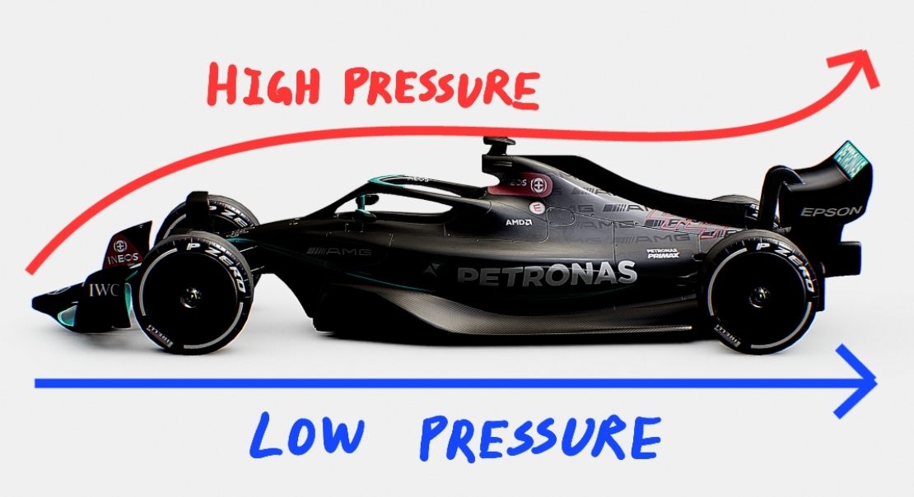
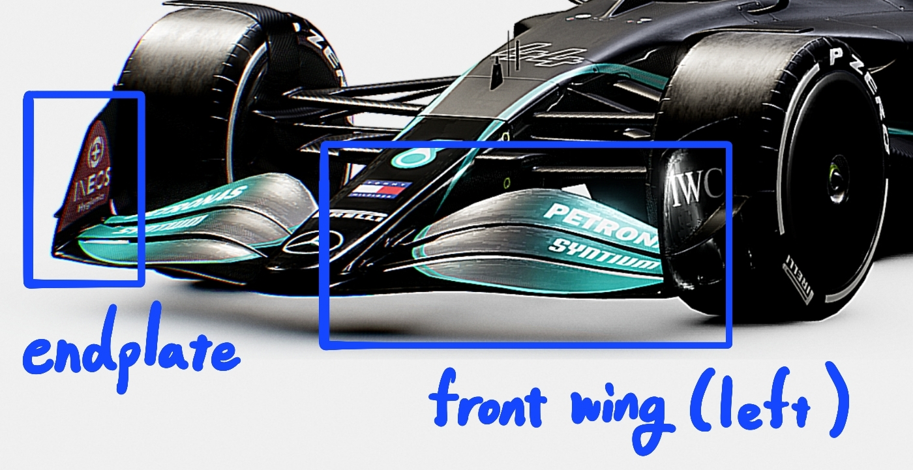
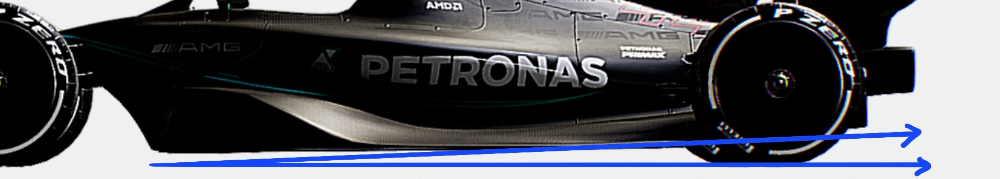
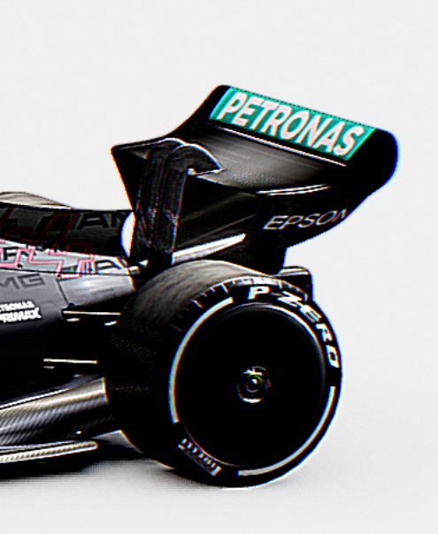
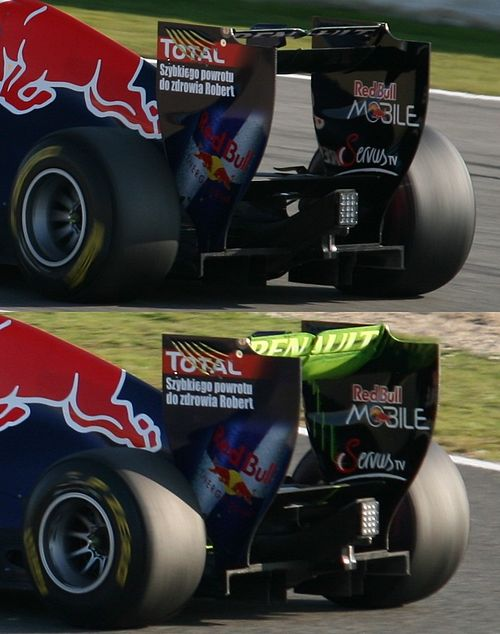

Formula 1 has been around for decades, but its popularity slowly declined over the years, only to surge back again in 2020. It’s a *"heart-racing"*, inspiring sport that I’ve loved dearly. One of its biggest selling points is the car itself, which is a multi-million-dollar machine. Each F1 car is a masterpiece, showcasing the finest work of the world’s top engineers.

As an engineering student with an interest in F1, I appreciate the deep science behind how an F1 car works, especially in **grip, power, and aerodynamics**.

Before diving into the details, it’s important to understand that **Formula 1 cars are not the absolute fastest machines humans can build**. Rather, Formula 1 operates more like a massive, collaborative school project. Strict financial and technical regulations bind the engineers, and **within those constraints, multiple companies push the limits of innovation** to develop their own uniquely optimized race cars. Therefore, the overall structure of a Formula 1 car looks alike, but the details may vary.

> **Warning:** the research is based on the regulations and publicly available models of 2023 Formula 1 cars. It's important to note that car designs can vary significantly between teams, and structural elements often evolve from season to season.
>
> The explanation below is a simplified overview of the complex science behind a Formula 1 car, so please take it with a grain of salt.

## Aerodynamics

### 1. Overview of Downforce

From the shape of a Formula 1 car, we can identify two distinct airflow patterns. The air moving over the top of the car follows a longer, curved path, while the air underneath flows through a tighter, straighter channel. Due to these differences, the velocity of the airflow beneath the car is higher than above. According to Bernoulli’s principle, **higher velocity corresponds to lower pressure**, meaning the pressure above the car is much higher than below. This **pressure difference generates downforce**, which helps the car stay glued to the track at high speeds.

But how does downforce actually keep a Formula 1 car *“glued”* to the track, and why is it so crucial? At speeds reaching up to 375 km/h, and an average racing speed around 320 km/h, maintaining grip is everything. **Downforce presses the car downward**, increasing the normal force on the tires. This, in turn, **boosts the friction between the tires and the track surface**. More friction means better grip, allowing the car to corner at high speeds without sliding off. Without sufficient downforce, a Formula 1 car would struggle to stay on the track during sharp turns, especially at such extreme velocities.

The design and concept of generating downforce in a Formula 1 car is very similar to how an airplane generates lift, but flipped upside down. While an airplane wing creates lift to push the aircraft upward, the wings on a Formula 1 car are inverted to create a downward force. The total downforce generated by the car is so great that, **in theory, the car could drive upside down on a ceiling**.

### 2. Front Wing

The front wing is likely the first thing that comes to mind when people imagine a race car, as it stands out prominently from the rest of the body. Positioned at the very front, it leads the way as the car slices through the air, splitting the airflow into two streams. However, **its primary role isn't just to cut through the air — it's to generate carefully controlled vortices**.

The multiple curved elements that make up the front wing are carefully designed to generate **vortices, which are swirling streams of air that help manage airflow around the car**. These vortices are created when the high-speed airflow over the wing crashes with the slower air beneath it. **However, if these vortices are not properly controlled, they can create significant aerodynamic drag, which slows the car down. To mitigate this, endplates are added to the tips of the front wing**. These vertical panels help manage and redirect the vortices, reducing their intensity and guiding airflow more cleanly around the front tires and along the car’s body.

**In contrast, the inner edge of the front wing generates a clean and controlled Y250 vortex**, which travels along the floor of the car. This vortex acts like an **invisible barrier, helping to seal off the clean, high-speed airflow that passes underneath the car** from the turbulent air coming off the front tires. The Y250 vortex is a powerful swirling airflow generated around 250 mm from the centerline of the car; hence the name "Y250", where “Y” refers to the lateral axis. By stabilizing and guiding this underfloor airflow, the Y250 vortex helps **maximize downforce while minimizing aerodynamic disruption from surrounding components**.

### 3. Rake & Diffuser

The underside of a Formula 1 car sits extremely close to the ground and narrows toward the middle. When the car bounces slightly over uneven track surfaces, sparks can often be seen as the metal body scrapes against the track.

Many F1 teams also utilize a **design concept called rake, where the rear of the car is positioned higher than the front**. This angled setup **increases the volume of air flowing through the diffuser, further enhancing the low-pressure effect** and improving overall downforce. Additionally, allowing the accelerated air beneath the car to **rejoin the slower-moving air above more smoothly**, minimizing turbulence and reducing drag.

To ensure that goal, **a diffuser is integrated at the rear of the floor**. The diffuser **gradually expands the airflow channel**, helping to maintain low pressure while reducing turbulence. It also features vertical vanes, which guide and straighten the airflow, helping to form controlled vortices. These vortices **manage the large flow of air that exits from the rear of the car, enhancing the overall stability** of the car, especially during cornering.

### 4. Drag Reduction System (DRS)

 

The upward-curved rear wing plays **a major role in generating downforce**. Its multi-element, gapped design allows high-speed airflow from the top of the wing to interact more aggressively with the lower-pressure air underneath. This interaction, especially near the wing tips, leads to the formation of wingtip vortices, which are the swirling air that trails off the ends of the wing. Managing and shaping these vortices is a key part of **rear wing design, balancing between maximum grip and minimal drag**.

The rear wing design generates significant downforce, which is essential during cornering. **However, this shape also produces a substantial amount of drag**, which reduces the car’s top speed when downforce is less critical on a straight part of a track. Therefore, Formula 1 cars are **equipped with the Drag Reduction System (DRS)**, which allows a flap on the rear wing to open, **reducing the wing’s surface area**. This temporary change reduces drag, enabling higher speeds on straights and improving overtaking opportunities.

**The image on the right compares two different rear wing configurations. The top example shows the rear wing with DRS enabled**, where the upper flap is opened to reduce drag and allow for higher straight-line speed.

### 5. Dirty Air

From what we’ve seen so far, the aerodynamics of a Formula 1 car are incredibly complex, with every component carefully designed to manage airflow and maximize speed. But what about the tires? Unlike the sculpted bodywork, **tires are exposed, round, and constantly rotating**, which makes them one of the most disruptive elements in the aerodynamic system. Engineers have little control over the turbulent air produced by the tires (at least for now), **which causes chaotic airflow, known as “dirty air”**. Dirty air not only reduces efficiency but also **interferes with the clean airflow needed for downforce**.

**To help mitigate the dirty air generated by tires, the car’s bodywork is carefully sculpted with aerodynamic curves, inlets, and deflectors that redirect turbulent airflow around the vehicle**. These design features help manage the wake from the front tires, guiding it smoothly along the car’s sides and away from sensitive aerodynamic components like the rear wing.

The tires aren't the only source of dirty air in a Formula 1 car — **the rear of the car also generates a large turbulent air**. After optimizing the bodywork for aerodynamic efficiency, engineers typically don’t focus on managing airflow after it leaves the car. In fact, producing a turbulent wake can be a tactical advantage, as **it disrupts the airflow for the car behind, making it harder for competitors to follow closely and overtake**.

However, as Formula 1 continues to evolve, future regulations may limit how much dirty air a car can produce. The goal is to promote closer racing and more overtaking opportunities, shifting the focus from defensive turbulence to aerodynamic fairness and competition.
