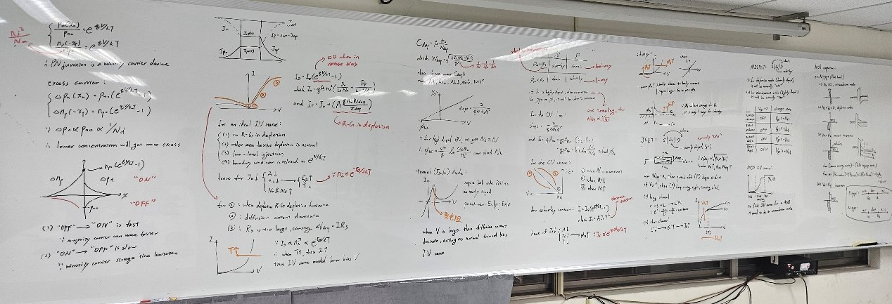

_My own photo: what I wrote for my Semiconductor Device class finals._

What an exciting yet depressing age we live in. Every month… Sorry, every few days, there is a “breakthrough” in the AI industry: a lab changing its name to superintelligence, brand-new ways to use your AI tools, or the newest model that crushes the others on a set of benchmarks. As a student who will be entering the job market in a few years’ time, I feel pressured and depressed at the same time by how our society is pushing AI. OpenAI’s latest release didn’t help this anxiety.

## 722 papers overnight

On the evening of October 6, 2026, OpenAI opened a public GitHub repository and uploaded 722 math papers (three have since been withdrawn because of an error), and all of them were written by an internal AI model that hasn’t been released to the public. Together, the papers claimed to resolve or advance 372 open problems in math and theoretical computer science. Although the papers weren’t peer-reviewed or submitted to journals, their release still made headlines and drew strong backlash in the mathematics community.

## What the mathematicians said

<figure class="post-figure post-figure--right">
  
  <figcaption>Terence Tao at IPAM’s Fireside Chat, March 2026. Photo: <a href="https://commons.wikimedia.org/wiki/File:Terence_Tao_at_IPAM%27s_Fireside_Chat_2026_(50m16s)_(cropped).jpg">Institute for Pure &amp; Applied Mathematics</a>, <a href="https://creativecommons.org/licenses/by/4.0/">CC BY 4.0</a></figcaption>
</figure>

In an interview published in mid-October, Terence Tao (Fields Medal winner) criticized how the release was handled. He said researchers already working on these problems, including junior mathematicians still building their skills, were never warned, and some saw years of progress overtaken overnight. After reading about ten of the papers, he gave a mixed verdict on the content. Some extended existing research, building on methods other mathematicians had already developed, while a few offered clever new ideas. But many remained hard to understand. Mathematician Sophie Huiberts went further, judging the papers so poorly explained that a journal would reject them outright. To some mathematicians, the release was a messy first draft that is now left for others to clean up.

## Another marketing move

I’m no mathematician (just an electrical engineering student), but I still have a strong opinion on this news. From what I’ve seen over the past few years of AI posts and updates, this is just another of OpenAI’s marketing methods. This 722-paper release sparked news, reports, and interviews about how strong AI is right now, especially OpenAI’s. From out-of-context headlines, people who just swipe through online news will form a strong impression of OpenAI, but if you dig just a little deeper into interviews and blog posts from mathematicians, you’ll find these papers could be yet another form of AI slop. I would not discredit the new ideas and applications the model used, but at its core, AI mostly builds on existing methods to form its “solution”. From the AI models I know and have used (even trained and learned about), this thing does not think like we humans do, even though we tried to reverse-engineer our brains. It most likely just smashed the possible public solutions and methods together and tried to make it make sense.

## The joy of practice

These 722 papers disgust me—deeply. As a student myself (with a passion for IC design), sometimes I also feel like AI models have taken away all the fun of practicing. Terence Tao noted that moderately difficult problems like many of these have traditionally been how students and postdocs build skills. In my view, what OpenAI did was ruin that way of learning. Even though I’m not a mathematician, I can imagine what those students must feel when seeing those papers getting posted to the public, unannounced. It must be devastating, especially if one of those publications is a proof of a problem you are still solving. But even if what you are tackling right now is not in those 722 papers, it is still depressing to think about. What the AI model is doing is just sucking the joy and excitement out of someone’s work; even though it may not be extremely challenging, almost unsolvable, or hold great meaning for the academic field, it is something to practice on, to enjoy, to prove to yourself that you are capable of something harder. If students don’t practice, then how do we do something that is truly hard?

Right now, in the job market, you may notice far fewer entry-level jobs, or jobs requiring you to have at least several years of experience to even apply to. There are reports of AI causing companies to shrink their need for entry-level roles, while still requiring junior or senior engineers to make everything run smoothly. This works in the short term, even helping them save money right now. If we think further, where do junior engineers come from if there are no entry-level roles? I believe those CEOs understand this concept, but who will want to waste money on training an entry-level engineer when that engineer can be partially replaced by AI? They just push the problem away and believe someone other than themselves will solve it, but I totally understand this type of thinking; we are human after all.

## A story from my capstone

I have a story to tell. My capstone project is to create a hardware system that runs an SNN on an FPGA board. This RTL project used to be hard for AI to do because of the blocking and non-blocking issues, good hardware style, and the difficulty of grasping such a large hardware system. Right now, as of October 2026, it really does understand how hardware works and can write usable code for it, but from my personal view and experience, the AI models still have a hard time grasping large concepts and designing power-efficient solutions (sometimes their recommendations are faulty). One time, I asked if one of the components in my capstone project was redundant, because I believed that the BRAM could be halved, and it confirmed my suspicion. The confirmation was not the surprise—the surprise was that it gave me another method, a better one, removing all the BRAM. What it did was something that most people (or I’m just too dumb) would not think about: a brand-new idea that is not standard but works quite well, which involves no memory and only one combinational check. I implemented the idea myself (shaving off redundant hardware that it recommended), and it did remove latency and required no saving of the values.

## Will AI replace IC design?

One of my school’s professors (NCHU) told my underclassmen that digital IC design would be replaced by AI, which caused most of the students that year to run to analog IC, even though it was not something they were passionate about. I wouldn’t say he was wrong, but I wouldn’t say he was right either. This is just the same problem software and UI engineers are facing. Personally, I don’t think they will be truly “replaced”; the job market still requires them to some extent, but who knows, truly. If those engineering jobs were to be replaced in the future, then the same logic should also apply to all engineers whose jobs require logic and thinking, the things that AI tools are exceptional at. In the end, analog IC is also work where AI can help with routing, testing, and even the analog layout; it is just a matter of time.

## Just a tool

It is depressing to see how most people in our society are viewing and using AI models, and not really understanding what they are at their core. Let’s be optimistic; for now, AI is just a tool, like a calculator (but much better), needing people to hone its power and use it correctly to get the best output, not another pile of slop that brings no meaning.
