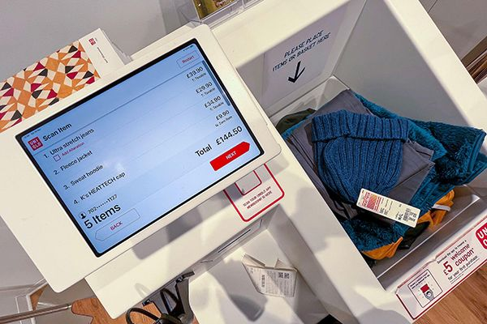
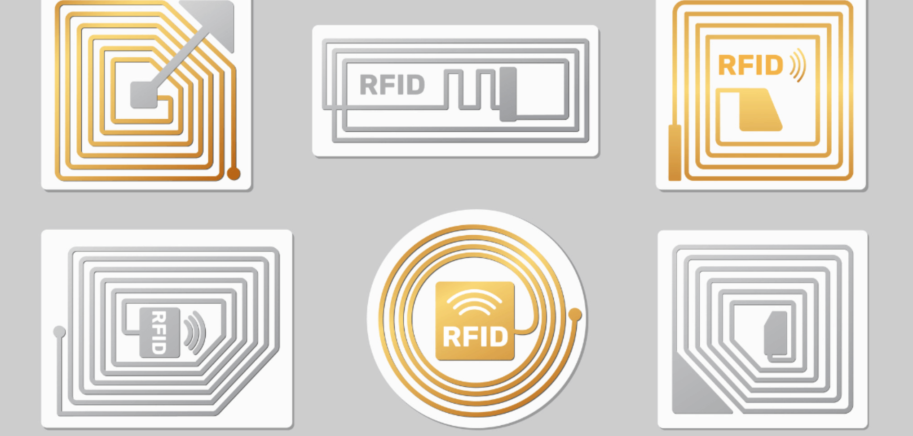
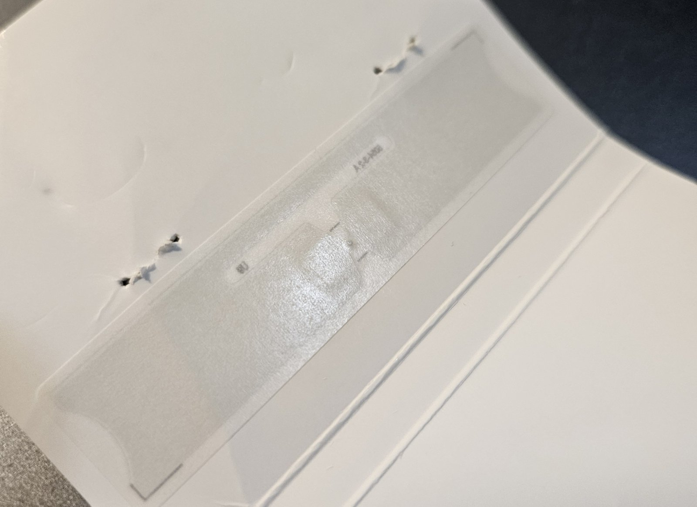

Do you remember the first time you saw this? You walk into a clothing store, placing your items in a box, and watching as everything was checked out automatically. I doubt I’m the only one who found it fascinating.

It uses **RFID technology, which stands for radio frequency identification**, and society uses it daily. RFID uses radio waves to transfer data from the tag to the reader, bypassing most materials in the way; therefore, it doesn’t require a direct pathway like barcodes.

I bet you have already used this technology today. It is utilized in our IC card, pet scanners, and car access to the garage. It is widely used in different applications.

## History of RFID

This tracking device is not a modern technology. It was **invented in 1985 by Charles Walton**. On the internet, there is a misunderstanding that it was used in World War II, which happened in 1939. It is said that RFID is used by planes to differentiate which side you are on. The technology used is the **IFF (Identification Friend or Foe) system, which is not known as RFID, but a precursor to modern RFID**.

Although Charles Walton is the first person to receive a patent for a modern RFID device, it started to take shape before that.

Charles Walton’s RFID device is a passive system, not needing any battery connected to the RFID chip, where the reader supplies the power to the tag. Later developments introduced active RFID tags, which require batteries; this allows them to have a longer reading range for military use and tracking devices.

## Passive vs. Active RFID

The concept of an RFID tag is simple: it consists of **a circuit and an ID chip**. Its operation primarily relies on **electromagnetic induction**, a principle we learn in high school physics. To enable this, the circuit, which is usually made of copper or aluminum that forms a loop, typically in a circular or rectangular shape, depending on the size and design constraints of the RFID tag.

**Passive RFID Tag:**
Passive RFID tags do not require an internal power source; instead, they are activated by the electromagnetic signal emitted from an RFID reader. These tags are smaller, more affordable, and commonly embedded in everyday items such as access cards, product labels, and clothing tags.

**Active RFID Tag:**
Active RFID tags contain their own power source (battery), which allows them to transmit signals over much longer distances. They are mainly used in applications that require real-time tracking over large areas, such as vehicle tracking or asset management; which exceeds the needs of typical retail scenarios like clothing store checkouts.

## Where is the Tag?

It’s no surprise that Uniqlo chooses **passive RFID tags** for their self-checkout and inventory management systems, a classic case of killing two birds with one stone.

A passive RFID tag typically consists of:

- **IC chip:** Stores a unique ID and manages communication.
- **Antenna:** Usually made from etched or printed conductive materials, most commonly aluminum or sometimes copper.
- **No battery:** The tag is powered by the reader’s signal, keeping it small and cost-effective.

In UNIQLO’s case, the aluminum antenna is often flat, printed, and embedded in plastic or paper. That’s why you don’t see obvious copper wires, because it’s thin, flexible, and **neatly hidden inside the price tag or label sticker**. So next time you buy clothes from Uniqlo, take a closer look at the price label. You might spot a tiny RFID tag — a simple but powerful piece of tech working quietly behind the scenes.

*I bought a shirt from UNIQLO, and this is the RFID tag hidden inside its price tag. Tear the tag open and you can see it clearly.*
